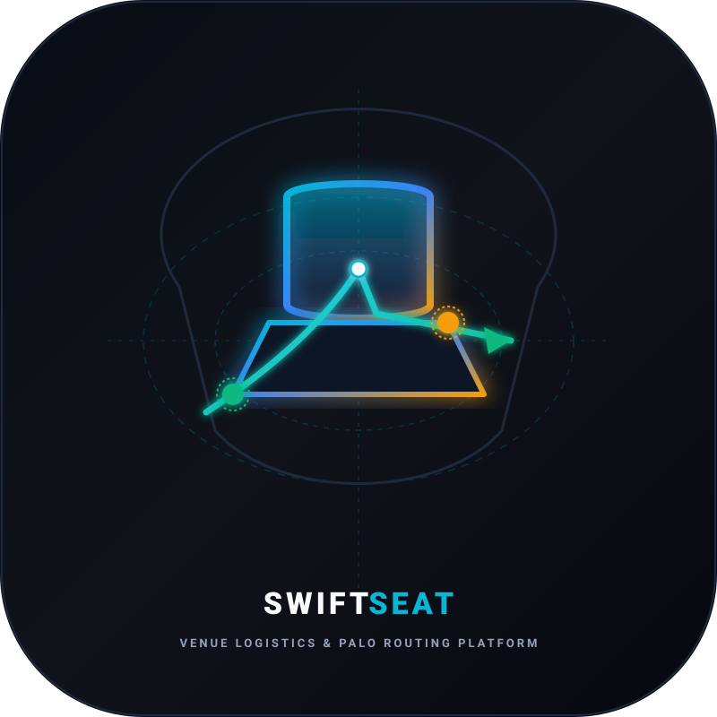
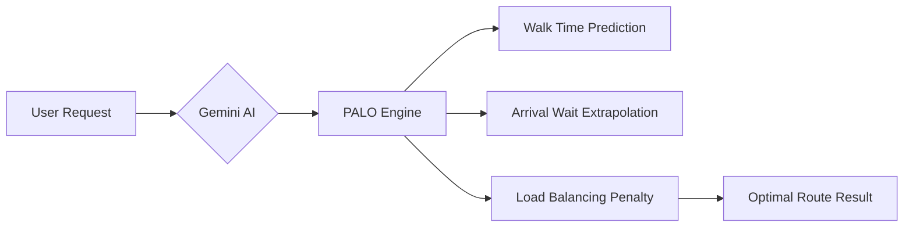

<p align="center">
  
</p>

<h1 align="center">SwiftSeat</h1>

<p align="center">
  <strong>Smart Venue Experience Assistant, Predictive PALO Algorithm, &amp; Gemini AI Stadium Logistics.</strong>
</p>

<p align="center">
  
  
  
  
  <a href="future.md"></a>
</p>

---

## 🚀 The Vision

**SwiftSeat** addresses the critical logistical challenges of modern stadiums: crowd congestion, concession wait times, and emergency response. By integrating Google Cloud Services and a predictive routing algorithm, we provide fans with a **seamless, frictionless journey** from entry to exit.

---

## 📱 Platforms

*   **Mobile App (Recommended)**: Built with **Expo / React Native**. Experience the tactile "Kinetic Oasis" design system.
*   **Web Console**: Built with **Vite / React**. Engineered for venue administrators and stadium operations teams.

---

## 🧠 Core Innovation: The PALO Algorithm

**Predictive Arrival-time, Load-balanced Optimization** — our routing engine doesn't just find the *currently* shortest concession stand line. It projects wait times at the attendee's calculated **arrival timestamp**, factoring in walk distance, queue flow rates, and global concourse balancing.



---

## 🎨 Design System: "Kinetic Oasis"

*   **Atmospheric Navigator**: Deep midnight palette (`#10141a`) optimized for outdoor stadium-glare legibility.
*   **Glassmorphism**: 20px background blurs for tactile physical depth.
*   **No-Line Rule**: Tonal layering instead of 1px borders for a premium, integrated aesthetic.

---

## 📂 Repository Structure

```plaintext
/swiftSeat
├── mobile/            # React Native (Expo) mobile application
├── src/               # React (Vite) web console
├── backend/           # Python telemetry simulation and Gemini proxy
├── hardware/          # IoT beacon gateway firmware specifications
├── assets/            # Bespoke vector brand identity & media
└── Archives/          # Research, specifications, and architecture
```

---

## 🛠️ Setup & Development

### Mobile (Expo)
```bash
cd mobile
npm install
npx expo start
```
*Scan the QR code with **Expo Go** to test on a physical device.*

### Web (Vite)
```bash
npm install
npm run dev
```

---

## 📜 Accessibility & Inclusion

*   **Step-free Routing**: Dynamically prioritizes ADA-accessible ramps and elevators.
*   **High-Glare UX**: WCAG 2.1 AA compliant contrast ratios for bright outdoor sunlight.
*   **TTS Integration**: Narrated turn-by-turn directions for visually impaired fans.

---

## 🔮 Engineering Roadmap

To explore planned features including sub-meter BLE beacon positioning, live POS integration, ARCore/ARKit holographic navigation, and multi-agent emergency egress routing, read [future.md](future.md).

---

## 📄 License

Distributed under the MIT License.
